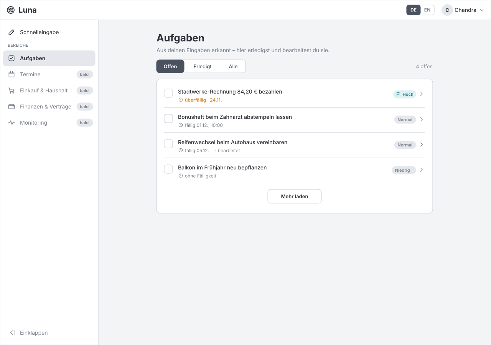

# Frontend – Aufbau der Anwendung

Visuelle Planung für Schritt 6 (Frontend: Seite für die manuelle Eingabe). Die Wireframes zeigen Aufbau und
Verhalten, nicht das endgültige Aussehen: Farben, Schriften und Icons sind dort nur Platzhalter.

## Wireframes

| Ansicht | Datei |
|---|---|
| Desktop, Navigation ausgeklappt | [desktop-expanded.svg](desktop-expanded.svg) |
| Desktop, Navigation eingeklappt (Icon-Leiste mit Tooltip) | [desktop-collapsed.svg](desktop-collapsed.svg) |
| Smartphone, Navigation geschlossen | [mobile-closed.svg](mobile-closed.svg) |
| Smartphone, Navigation als Overlay geöffnet | [mobile-open.svg](mobile-open.svg) |
| Platzhalter für Bereiche, die es noch nicht gibt | [placeholder.svg](placeholder.svg) |
| Logo: Vollmond mit angedeuteten Kratern | [logo.svg](logo.svg) |

## Festgelegt

### Grundaufbau

- **Kopfzeile** über die volle Breite: links „Luna“ mit Mond-Logo (führt zur Startseite), rechts der
  Sprachumschalter **DE/EN** und das **Benutzermenü** (Name aus Keycloak, „Abmelden“).
- **Navigation links** unter der Kopfzeile, daneben der Inhalt (zentriert, max. ca. 720 px breit).

### Navigation

- Einträge: **Schnelleingabe** (Startseite), darunter unter „Bereiche“ alle geplanten Bereiche:
  Aufgaben, Termine, Einkauf & Haushalt, Finanzen & Verträge, Monitoring.
- Bereiche, die es noch nicht gibt, tragen die Markierung **„bald“** und führen auf eine Platzhalter-Seite.
- **Ausgeklappt** (256 px): Icon und Text. **Eingeklappt** (64 px): nur Icons, der Name erscheint als
  **Tooltip** beim Überfahren bzw. bei Fokus; „bald“ wird zu einem Punkt am Icon.
- Umschalten über den Eintrag „Einklappen“/„Ausklappen“ am unteren Rand der Navigation. Der Zustand wird
  im Browser gemerkt.
- **Smartphone (bis 768 px):** Die Navigation ist ausgeblendet. Der **Burger-Button** in der Kopfzeile öffnet sie
  als **Overlay** über dem Inhalt (mit abgedunkeltem Hintergrund). Nach einer Auswahl, einem Klick auf den
  Hintergrund oder mit Escape schließt sie sich wieder.

### Startseite: Schnelleingabe

- Überschrift „Was steht an?“ mit kurzer Erklärung.
- **Freitextfeld** (Pflicht, höchstens 10.000 Zeichen) mit Zeichenzähler. Ein leeres Feld wird beim Absenden
  mit einem Hinweis am Feld abgelehnt.
- **Typ-Hinweis** (`typeHint`) als Chips mit Icon: „Automatisch“ (vorausgewählt), Aufgabe, Termin, Rechnung,
  Vertrag, Warnung, Notiz.
- **Absenden** per Button oder Strg + Enter. Danach wird das Feld geleert und der Typ-Hinweis auf „Automatisch“
  zurückgesetzt.
- **Rückmeldung (Variante B):** Unter dem Formular die Liste **„Letzte Eingaben“** mit Text, Zeitpunkt, Status
  (Wird analysiert / Analysiert / Fehlgeschlagen) und den daraus entstandenen Elementen. Eine neue Eingabe
  erscheint sofort oben mit „Wird analysiert“.
  Voraussetzung ist ein **List-Endpunkt in `luna-core`** (Schritt 5).

### Sprache

- Alle Texte über react-i18next in Deutsch und Englisch; der Umschalter in der Kopfzeile wechselt sofort.

## Entschieden in Schritt 6a

- Farben wie im Wireframe: Hintergrund **`#f3f4f6`**, Primärfarbe **`#4a5260`** (dunkles Grau); kräftige Farbe nur für
  Highlights: Petrol **`#1f7a8c`**. Schriften **Inter** und **Space Grotesk** (Überschriften).
- Icons aus **lucide-react**; das Logo bleibt das eigene Mond-SVG.
- Dunkler Modus automatisch nach Geräteeinstellung.
- Routen: `/`, `/tasks`, `/calendar`, `/shopping`, `/finance`, `/monitoring`.
- Navigation ausgeklappt 256 px; Einträge in 14 px, damit lange Namen neben „bald“ passen.

## Entschieden in Schritt 6c

- Die Liste „Letzte Eingaben“ aktualisiert sich per **Push-Signal** von `luna-core` (STOMP über WebSocket, Topic
  `/topic/inbound-events/manual`); sie zeigt die 10 neuesten Eingaben, „Mehr laden“ lädt je 10 weitere nach.
- Zeitangaben relativ („vor 12 Min.“), das genaue Datum mit Uhrzeit als Tooltip.

## Aufgaben (Schritt 7a-3)

Visuelle Planung der Seiten für `luna-task`.

| Ansicht | Datei |
|---|---|
| Liste (Desktop) | [tasks-desktop.svg](tasks-desktop.svg) |
| Details und Bearbeiten (Desktop, mit Konflikt-Hinweis) | [task-detail-desktop.svg](task-detail-desktop.svg) |
| Liste (Smartphone) | [tasks-mobile.svg](tasks-mobile.svg) |
| Details und Bearbeiten (Smartphone) | [task-detail-mobile.svg](task-detail-mobile.svg) |

### Liste (`/tasks`)

- Navigation: „Aufgaben“ verliert die Markierung „bald“.
- Überschrift „Aufgaben“ mit kurzer Erklärung, darunter der Umschalter **Offen** (Standard) / **Erledigt** / **Alle**
  und rechts die Anzahl.
- Je Aufgabe: **Checkbox** zum Erledigen bzw. Wieder öffnen direkt in der Liste, Titel, Fälligkeit
  („fällig 01.12., 10:00“, „ohne Fälligkeit“), Priorität als Markierung und ein Pfeil zur Detailseite (ganze Zeile
  klickbar).
- Sortierung wie im Backend: Fälligkeit aufsteigend, ohne Fälligkeit zuletzt.
- Je 20 Einträge, **„Mehr laden“** lädt weitere.
- Aktualisierung per **Push-Signal** von `luna-task` (`/topic/tasks`), z. B. wenn eine neue Aufgabe aus der
  Schnelleingabe entsteht.

### Details und Bearbeiten (`/tasks/:id`)

- Zurück-Link „Aufgaben“, Titel als Überschrift, Status (Offen/Erledigt) und Version/letzte Änderung.
- Button **„Erledigen“** bzw. **„Wieder öffnen“** rechts neben der Überschrift (Smartphone: darunter).
- Formular: **Titel** (Pflicht, max. 500), **Beschreibung** (max. 10.000), **Fälligkeit**, **Priorität**
  (Niedrig/Normal/Hoch als Chips). **„Speichern“** sendet `PUT /tasks/{id}` mit der geladenen `version`,
  **„Verwerfen“** setzt das Formular zurück.
- **Konflikt (409):** Hinweis über dem Formular „Die Aufgabe wurde inzwischen geändert. Deine Eingaben sind nicht
  gespeichert.“ mit **„Neu laden“**.
- Karte **Herkunft**: „Aus der Schnelleingabe erkannt“, bei bearbeiteten Aufgaben der Hinweis, dass neue
  Analyse-Ergebnisse sie nicht mehr überschreiben, sowie Anlage- und Änderungszeitpunkt.

### Entschieden

- **Fälligkeit:** Datum und optionale Uhrzeit. Ohne Uhrzeit wird 00:00 Ortszeit gespeichert und in der Anzeige
  weggelassen („fällig 05.12.“).
- **Überfällig** (Fälligkeit vor heute bzw. vor jetzt bei gesetzter Uhrzeit, nur offene Aufgaben): Text und Icon in
  **Orange `#d9822b`**, fett.
- Priorität **„Hoch“** als Petrol-Markierung (`#1f7a8c`), „Normal“ und „Niedrig“ grau.

### Technik

- Eigener API-Wrapper `src/api/luna-task/` aus `luna-task/openapi.yaml`, Basis-URL `VITE_LUNA_TASK_URL`
  (lokal `http://localhost:7082`, sonst `/api/luna-task`).
- Stores `TaskListStore` und `TaskStore` (Details/Bearbeiten) im `RootStore`.
- E2E: Schnelleingabe → Aufgabe erscheint per Push in der Liste → bearbeiten → erledigen.

## Warnungen und Notizen (Schritt 7b)

| Ansicht | Datei |
|---|---|
| Warnungen, Liste (Desktop / Smartphone) | [alerts-desktop.svg](alerts-desktop.svg), [alerts-mobile.svg](alerts-mobile.svg) |
| Warnung, Details (Desktop) | [alert-detail-desktop.svg](alert-detail-desktop.svg) |
| Notizen, Liste (Desktop / Smartphone) | [notes-desktop.svg](notes-desktop.svg), [notes-mobile.svg](notes-mobile.svg) |
| Notiz, Details und Bearbeiten (Desktop) | [note-detail-desktop.svg](note-detail-desktop.svg) |

- **Navigation:** Aufgaben, **Notizen** (`/notes`), Termine, Einkauf & Haushalt, Finanzen & Verträge, Monitoring,
  **Warnungen** (`/alerts`).
- **Warnungen – Liste:** Umschalter Aktiv (offen + bestätigt, Standard) / Offen / Bestätigt / Behoben / Alle (auf dem
  Smartphone horizontal scrollbar); je Warnung Schwere, Titel, betroffenes System, Eingang (relativ), Status und bei
  offenen Warnungen der Button **„Bestätigen“** direkt in der Zeile. Sortierung: schwerste zuerst, dann neueste.
- **Schwere:** Kritisch in Orange (`#d9822b`), Warnung in Petrol (`#1f7a8c`), Info grau.
- **Warnung – Details:** Inhalte nur lesen (keine Bearbeitung); Aktionen je Status: offen → „Bestätigen“ und
  „Als behoben“, bestätigt → „Als behoben“ und „Wieder öffnen“, behoben → „Wieder öffnen“. Karte „Herkunft“ mit Eingang,
  Bestätigt und Behoben.
- **Notizen – Liste:** Umschalter Aktiv (Standard) / Archiviert / Alle; Titel, Zusammenfassung (zwei Zeilen),
  Eingang und „bearbeitet“; neueste zuerst.
- **Notiz – Details:** Formular mit Titel und Zusammenfassung (beide Pflicht), Speichern mit `version`
  (Konflikt-Hinweis mit „Neu laden“), Verwerfen, „Archivieren“ bzw. „Wiederherstellen“.
- Beide Listen aktualisieren sich per Push (`/topic/alerts`, `/topic/notes`).

## Termine (Schritt 7c)

| Ansicht | Datei |
|---|---|
| Termine, Liste (Desktop / Smartphone) | [appointments-desktop.svg](appointments-desktop.svg), [appointments-mobile.svg](appointments-mobile.svg) |
| Termine, Monat (Desktop / Smartphone) | [appointments-month-desktop.svg](appointments-month-desktop.svg), [appointments-month-mobile.svg](appointments-month-mobile.svg) |
| Termin, Details und Bearbeiten (Desktop) | [appointment-detail-desktop.svg](appointment-detail-desktop.svg) |

- **Route:** `/calendar` (Navigation „Termine“), Details unter `/calendar/:id`.
- **Zwei Ansichten:** Liste (Standard) und Monat; Umschalter rechts in der Werkzeugleiste, die Wahl wird im
  `localStorage` gemerkt (`luna.appointments.view`).
- **Liste:** Umschalter Kommend (Standard) / Vergangen / Alle; nach Tagen gruppiert mit Überschrift („Heute, …“,
  „Morgen, …“, sonst Wochentag und Datum). Je Termin Zeit (`10:00–11:00`, nur Beginn, „ganztägig“), Titel, Ort.
  Kommend früheste zuerst, Vergangen späteste zuerst; „Mehr laden“ wie in den anderen Listen.
- **Kommend/Vergangen** entscheidet das **effektive Ende**: laufende Termine zählen als kommend.
- **Mehrtägige Termine** erscheinen an jedem Tag („Tag 2 von 5“; erster Tag „ab 18:00“, letzter „bis 10:00“,
  dazwischen „ganztägig“). In „Kommend“ beginnen laufende Termine erst bei heute.
- **Ganztägige Termine:** Beginn 00:00 Ortszeit, `end` = letzter Tag (00:00).
- **Abgesagte Termine** bleiben sichtbar: durchgestrichen und mit Tag „abgesagt“.
- **Monat:** Woche beginnt am Montag; Monat vor/zurück und „Heute“; heute in Petrol hervorgehoben. Ein Termin im Raster
  führt zu seinen Details; ein Klick auf die Tageszahl zeigt die Termine des Tages unterhalb des Rasters. Auf dem
  Smartphone Punkte statt Titeln. Geladen wird über `GET /appointments/range` (alle Termine, die den Monat berühren).
- **Termin – Details:** Formular mit Titel (Pflicht), „Ganztägig“, Beginn (Datum + Uhrzeit, Pflicht), Ende bzw.
  letzter Tag (optional, nicht vor Beginn), Ort, Beschreibung; Speichern mit `version` (Konflikt-Hinweis mit
  „Neu laden“), Verwerfen, „Absagen“ bzw. „Wiederherstellen“. Karte „Herkunft“ mit Angelegt, Geändert und Abgesagt.
- Beide Ansichten aktualisieren sich per Push (`/topic/appointments`).

## Offen (_TODO_)

- Monitoring als ein Eintrag oder später mit Unterpunkten (Heimnetz & Server, Smart Home & Energie,
  Gesundheit & Gewohnheiten, Luna selbst).
