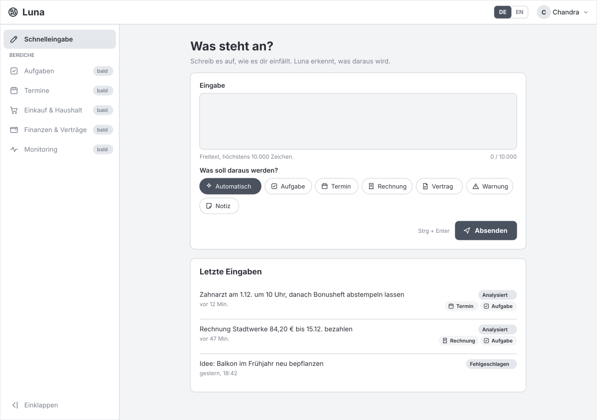

# Frontend – Aufbau der Anwendung

Visuelle Planung für Schritt 6 (Frontend: Seite für die manuelle Eingabe). Die Wireframes zeigen Aufbau und
Verhalten, nicht das endgültige Aussehen: Farben, Schriften und Icons sind dort nur Platzhalter.

## Wireframes

| Ansicht | Datei |
|---|---|
| Desktop, Navigation ausgeklappt | [desktop-expanded.svg](desktop-expanded.svg) |
| Desktop, Navigation eingeklappt (Icon-Leiste mit Tooltip) | [desktop-collapsed.svg](desktop-collapsed.svg) |
| Smartphone, Navigation geschlossen | [mobile-closed.svg](mobile-closed.svg) |
| Smartphone, Navigation als Overlay geöffnet | [mobile-open.svg](mobile-open.svg) |
| Platzhalter für Bereiche, die es noch nicht gibt | [placeholder.svg](placeholder.svg) |
| Logo: Vollmond mit angedeuteten Kratern | [logo.svg](logo.svg) |

## Festgelegt

### Grundaufbau

- **Kopfzeile** über die volle Breite: links „Luna“ mit Mond-Logo (führt zur Startseite), rechts der
  Sprachumschalter **DE/EN** und das **Benutzermenü** (Name aus Keycloak, „Abmelden“).
- **Navigation links** unter der Kopfzeile, daneben der Inhalt (zentriert, max. ca. 720 px breit).

### Navigation

- Einträge: **Schnelleingabe** (Startseite), darunter unter „Bereiche“ alle geplanten Bereiche:
  Aufgaben, Termine, Einkauf & Haushalt, Finanzen & Verträge, Monitoring.
- Bereiche, die es noch nicht gibt, tragen die Markierung **„bald“** und führen auf eine Platzhalter-Seite.
- **Ausgeklappt** (256 px): Icon und Text. **Eingeklappt** (64 px): nur Icons, der Name erscheint als
  **Tooltip** beim Überfahren bzw. bei Fokus; „bald“ wird zu einem Punkt am Icon.
- Umschalten über den Eintrag „Einklappen“/„Ausklappen“ am unteren Rand der Navigation. Der Zustand wird
  im Browser gemerkt.
- **Smartphone (bis 768 px):** Die Navigation ist ausgeblendet. Der **Burger-Button** in der Kopfzeile öffnet sie
  als **Overlay** über dem Inhalt (mit abgedunkeltem Hintergrund). Nach einer Auswahl, einem Klick auf den
  Hintergrund oder mit Escape schließt sie sich wieder.

### Startseite: Schnelleingabe

- Überschrift „Was steht an?“ mit kurzer Erklärung.
- **Freitextfeld** (Pflicht, höchstens 10.000 Zeichen) mit Zeichenzähler. Ein leeres Feld wird beim Absenden
  mit einem Hinweis am Feld abgelehnt.
- **Typ-Hinweis** (`typeHint`) als Chips mit Icon: „Automatisch“ (vorausgewählt), Aufgabe, Termin, Rechnung,
  Vertrag, Warnung, Notiz.
- **Absenden** per Button oder Strg + Enter. Danach wird das Feld geleert und der Typ-Hinweis auf „Automatisch“
  zurückgesetzt.
- **Rückmeldung (Variante B):** Unter dem Formular die Liste **„Letzte Eingaben“** mit Text, Zeitpunkt, Status
  (Wird analysiert / Analysiert / Fehlgeschlagen) und den daraus entstandenen Elementen. Eine neue Eingabe
  erscheint sofort oben mit „Wird analysiert“.
  Voraussetzung ist ein **List-Endpunkt in `luna-core`** (Schritt 5).

### Sprache

- Alle Texte über react-i18next in Deutsch und Englisch; der Umschalter in der Kopfzeile wechselt sofort.

## Entschieden in Schritt 6a

- Farben wie im Wireframe: Hintergrund **`#f3f4f6`**, Primärfarbe **`#4a5260`** (dunkles Grau); kräftige Farbe nur für
  Highlights: Petrol **`#1f7a8c`**. Schriften **Inter** und **Space Grotesk** (Überschriften).
- Icons aus **lucide-react**; das Logo bleibt das eigene Mond-SVG.
- Dunkler Modus automatisch nach Geräteeinstellung.
- Routen: `/`, `/tasks`, `/calendar`, `/shopping`, `/finance`, `/monitoring`.
- Navigation ausgeklappt 256 px; Einträge in 14 px, damit lange Namen neben „bald“ passen.

## Entschieden in Schritt 6c

- Die Liste „Letzte Eingaben“ aktualisiert sich per **Push-Signal** von `luna-core` (STOMP über WebSocket, Topic
  `/topic/inbound-events/manual`); sie zeigt die 10 neuesten Eingaben, „Mehr laden“ lädt je 10 weitere nach.
- Zeitangaben relativ („vor 12 Min.“), das genaue Datum mit Uhrzeit als Tooltip.

## Offen (_TODO_)

- Monitoring als ein Eintrag oder später mit Unterpunkten (Heimnetz & Server, Smart Home & Energie,
  Gesundheit & Gewohnheiten, Luna selbst).
